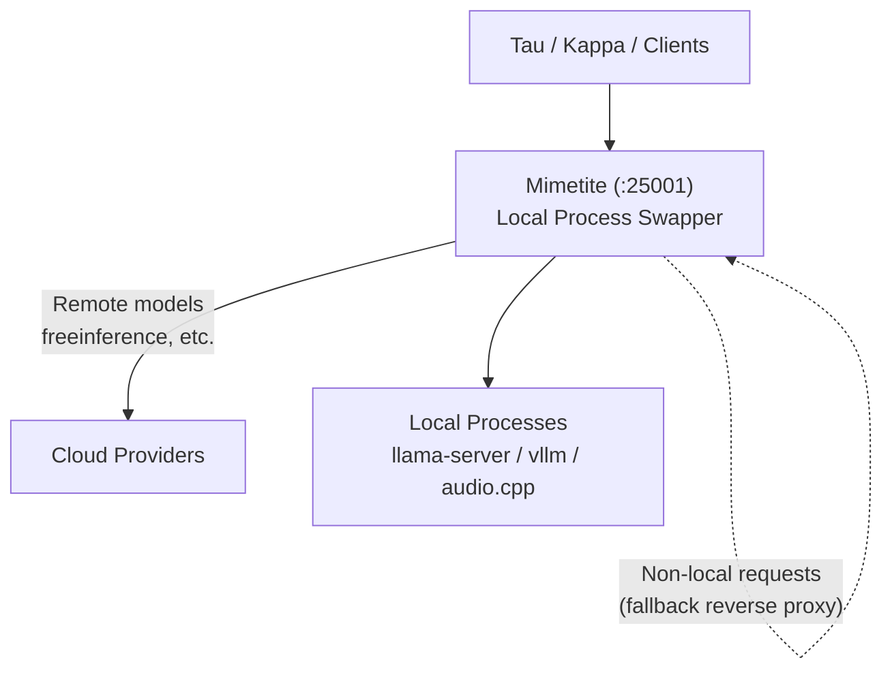

# 🏔️ Mimetite — Local Inference Engine Swapper

> *Part of [**the geode pen**](https://github.com/toxicwind/geode) — high-performance local inference orchestration.*

**Mimetite** is the dedicated local inference server and model hot-swapper for the pens stack (listening on port `:25001`). It manages local hardware resources (NVIDIA RTX 3090 24GB VRAM + AMD Ryzen 7 8700F Zen 4 AVX-512) and on-demand model lifecycle for `.gguf` models and local inference backends.

---

## Architecture & Provider Decoupling

Per pens doctrine, **all external provider routing belongs strictly to Mimetite (`:25193`)**. Mimetite contains no bespoke external provider definitions or freeproxies.



- **Local Process Lifecycle**: Starts local engines on-demand when a model is requested, and frees VRAM on idle timeout or eviction.
- **Reverse Proxy Delegation**: If a non-local model request reaches Mimetite, it proxies the request directly to Mimetite (`http://127.0.0.1:25193`).
- **Mimetite Integration**: Registered in Mimetite's `PROVIDER_DEFS` as `mimetite` (`http://127.0.0.1:25001/v1`), serving local models (`beellama/exaone`, `beellama/qwen-flash`, `turboquant/heretic-27b`, etc.).

---

## Features

- **On-demand Local Switching**: Automatically starts and unloads local inference servers (`llama-server`, `vllm`, `stable-diffusion.cpp`, `audio.cpp`, `ComfyUI`).
- **VRAM & Matrix Eviction**: Prevents Out-Of-Memory crashes on local GPUs with configurable eviction costs and concurrency FIFO queues.
- **OpenAI & Anthropic Compatible**:
  - `v1/chat/completions` & `v1/completions`
  - `v1/messages` (Anthropic API compatibility)
  - `v1/embeddings` & `v1/rerank`
- **Management & Observability**:
  - `GET /running` — list currently active and loaded local models
  - `POST /api/models/unload` — unload all models from VRAM
  - `POST /api/models/unload/:model_id` — unload a specific model
  - `GET /health` & `GET /metrics` — health check and Prometheus GPU/system metrics

---

## Configuration (`config.local.yaml`)

```yaml
healthCheckTimeout: 300
logLevel: debug
logToStdout: both
metricsMaxInMemory: 5000
startPort: 25001

store:
  path: /home/toxic/.local/share/mimetite/store.db

models:
  "beellama/exaone-4-0-1-2b-iq4xs":
    cmd: "llama-server -m /path/to/exaone.gguf --port ${PORT} -c 16384"
    name: "EXAONE 4.0 1.2B"
```

---

## Build & Run

```bash
# Start locally
go run ./cmd/main.go --config config.local.yaml

# Run tests
go test ./...
```
